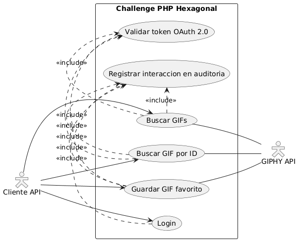
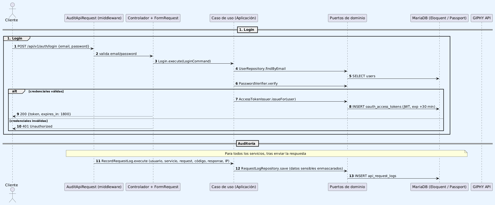
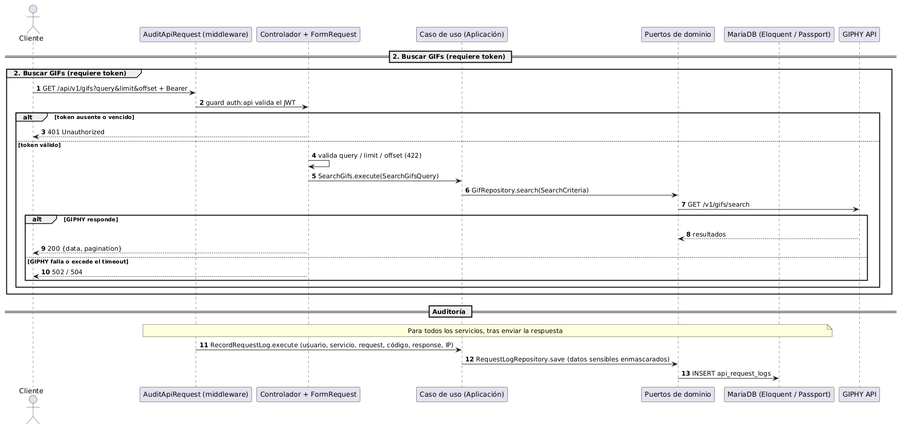
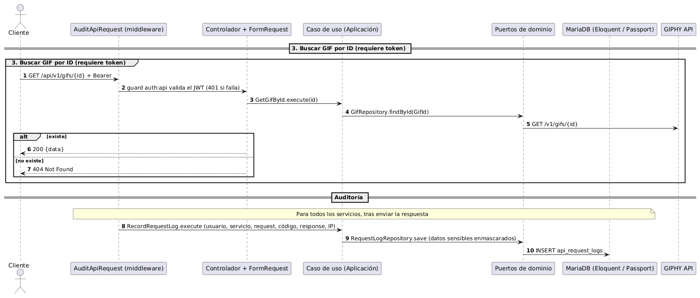
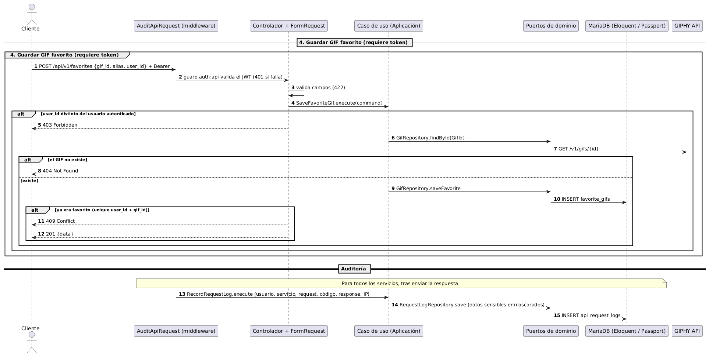
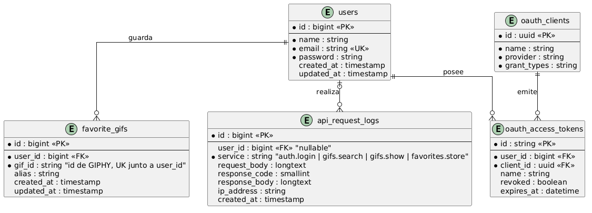

# Challenge PHP Hexagonal — API REST + GIPHY

API REST (Laravel 13, PHP 8.4) con arquitectura **Hexagonal + DDD** que se integra con la API de [GIPHY](https://developers.giphy.com/), autenticada con **OAuth 2.0** (Laravel Passport) y con auditoría persistente de cada interacción.

## Servicios

Base URL: `http://localhost:8000/api/v1`. Todas las respuestas son JSON. Los servicios marcados con \* requieren `Authorization: Bearer <token>`.

| Servicio | Método y ruta | Entrada | Salida |
| :--- | :--- | :--- | :--- |
| Login | `POST /auth/login` | `email`, `password` | `200` `{ token, token_type, expires_in, expires_at }` — expira a los **30 minutos** |
| Buscar GIFs \* | `GET /gifs` | `query` (requerido), `limit` (1-50, def. 25), `offset` (0-4999, def. 0) | `200` `{ data: [gif], pagination: { total_count, count, offset } }` |
| Buscar GIF por ID \* | `GET /gifs/{id}` | `id` en la ruta | `200` `{ data: gif }` |
| Guardar GIF favorito \* | `POST /favorites` | `gif_id`, `alias`, `user_id` (todos requeridos) | `201` `{ data: { id, user_id, gif_id, alias, created_at } }` |

Códigos de error: `401` token ausente/vencido o credenciales inválidas, `403` el `user_id` no es el del token, `404` GIF inexistente, `409` favorito duplicado, `422` validación, `429` demasiados intentos de login (10 por minuto), `502`/`504` GIPHY no disponible / sin respuesta.

Notas de diseño:

- **ID del GIF**: la consigna indica "numérico", pero GIPHY identifica sus GIFs con cadenas alfanuméricas (p. ej. `xT9IgzoKnwFNmISR8I`), por lo que se aceptan IDs alfanuméricos.
- **`user_id` al guardar favoritos**: es requerido y debe coincidir con el usuario autenticado; si no, `403`.
- Antes de guardar un favorito se verifica que el GIF exista en GIPHY (`404` si no).
- **OAuth 2.0**: el login emite un *personal access token* de Passport (JWT firmado, 30 min). Las rutas propias de Passport (`/oauth/*`) están deshabilitadas.

## Puesta en marcha con Docker

Requisitos: Docker y Docker Compose.

```bash
cp .env.example .env            # opcional: solo para correr artisan/tests localmente
export GIPHY_API_KEY=tu_api_key # clave gratuita en https://developers.giphy.com/dashboard/
docker compose up --build       # o docker-compose up --build
```

La API queda en `http://localhost:8000` (cambiar con `APP_PORT`). Al iniciar, el contenedor espera a MariaDB, ejecuta las migraciones, genera las llaves de Passport, crea el *personal access client* (`php artisan api:setup`) y siembra el usuario demo:

| Email | Password |
| :--- | :--- |
| `demo@example.com` | `password` |

Variables relevantes (ver `.env.example`): `GIPHY_API_KEY`, `GIPHY_BASE_URL`, `GIPHY_TIMEOUT`, `AUTH_TOKEN_EXPIRATION_MINUTES`, `SEED_DEMO_USER`.

Ejemplo rápido:

```bash
TOKEN=$(curl -s -X POST localhost:8000/api/v1/auth/login \
  -H 'Content-Type: application/json' \
  -d '{"email":"demo@example.com","password":"password"}' | jq -r .token)

curl -s "localhost:8000/api/v1/gifs?query=cats&limit=3" -H "Authorization: Bearer $TOKEN"
```

### Colección Postman

Importar en Postman los archivos de [docs/postman](docs/postman):

- `challenge-giphy-api.postman_collection.json` — los 4 servicios con su descripción y tests.
- `local.postman_environment.json` — environment con `base_url`, credenciales demo, `user_id`, etc.

Ejecutar primero **Login**: su script de test guarda el token en la variable de environment `token`, que el resto de las requests usa como Bearer token. *Buscar GIFs* guarda además el primer resultado en `gif_id`, usado por *Buscar GIF por ID* y *Guardar GIF favorito*.

### Desarrollo local sin Docker

```bash
composer install
cp .env.example .env && php artisan key:generate
# configurar DB_* (p. ej. DB_CONNECTION=sqlite y crear database/database.sqlite) y GIPHY_API_KEY
php artisan migrate --seed
php artisan api:setup
php artisan serve
```

## Tests

```bash
php artisan test        # SQLite en memoria; GIPHY se simula con Http::fake
composer test           # pint + phpstan + tests
```

- `tests/Unit`: dominio y casos de uso aislados de Laravel, usando *fakes* en memoria de los puertos (`tests/Fakes`).
- `tests/Feature`: flujos HTTP completos (autenticación, validación, códigos HTTP, auditoría) con GIPHY simulado.

## Arquitectura

Hexagonal + DDD, con dependencias que apuntan siempre hacia el dominio:

```text
app/
├── Domain/                     # Reglas de negocio puras (sin Laravel/Eloquent/HTTP)
│   ├── Auth/                   #   User, AccessToken, puertos UserRepository / PasswordVerifier / AccessTokenIssuer
│   ├── Gif/                    #   Gif, GifId, SearchCriteria, Alias, FavoriteGif, puerto GifRepository
│   ├── Audit/                  #   RequestLog, SensitiveDataRedactor, puerto RequestLogRepository
│   └── Shared/                 #   UserId, excepciones base
├── Application/                # Casos de uso: Login, SearchGifs, GetGifById, SaveFavoriteGif, RecordRequestLog
├── Infrastructure/             # Adaptadores
│   ├── Http/                   #   Controladores, FormRequests, Resources, middleware de auditoría, mapeo excepción → HTTP
│   ├── Persistence/Eloquent/   #   Modelos y repositorios Eloquent
│   ├── Auth/                   #   Adaptadores Passport / Hash
│   ├── Gif/                    #   GiphyEloquentGifRepository (implementa GifRepository: lee de GIPHY con GiphyClient, guarda favoritos con FavoriteGifStore)
│   ├── Console/                #   api:setup
│   └── Providers/              #   HexagonalServiceProvider (enlaza puertos → adaptadores), AppServiceProvider
```

- Los controladores solo traducen HTTP ↔ casos de uso; el acceso a datos y a GIPHY ocurre exclusivamente a través de puertos del dominio.
- Los errores de dominio (`InvalidCredentials`, `GifNotFound`, `FavoriteAlreadyExists`, `FavoriteOwnerMismatch`, `GifProviderUnavailable`, …) se traducen a códigos HTTP en `DomainExceptionRenderer`.
- **Auditoría**: el middleware `AuditApiRequest` registra, tras enviar la respuesta, cada interacción con los servicios en `api_request_logs`: usuario, servicio (nombre de la ruta: `auth.login`, `gifs.search`, `gifs.show`, `favorites.store`), cuerpo de la petición (JSON con los parámetros), código HTTP, cuerpo de la respuesta e IP de origen. Contraseñas y tokens se enmascaran como `[REDACTED]`. Si no se puede guardar un registro de auditoría, la respuesta no se ve afectada y el fallo se escribe en el log de Laravel (nivel `error`).
- **Auditoría a stdout**: con `AUDIT_LOG_STDOUT=true` cada interacción auditada se escribe además como una línea JSON (mensaje `api.audit`) en el canal `audit` (stdout), útil para recolectores de logs. Está activado por defecto en `docker-compose.yml` (`docker compose logs -f app`) y desactivado en `.env.example`. Se aplica mediante el decorador `LoggingRequestLogRepository`.
- **Logs de GIPHY**: cada llamada a GIPHY se registra en el log de Laravel (`GIPHY request completed.`) con ruta, filtros, código de estado y duración en ms (nunca la API key). Nivel `info` para respuestas correctas y `404`, `warning` para otros `4xx` y `error` para `5xx`, timeouts, fallos de conexión o API key no configurada.

## Diagramas

### Casos de uso



Los casos protegidos incluyen la validación del token; los cuatro servicios incluyen el registro de auditoría. *Guardar GIF favorito* consulta a GIPHY para verificar que el GIF exista.

### Secuencia (todos los casos de uso)









### Diagrama de datos (DER)



Las tablas `oauth_*` (Passport) se muestran de forma resumida; también existen `oauth_auth_codes`, `oauth_refresh_tokens` y `oauth_device_codes`, sin uso en este flujo.
